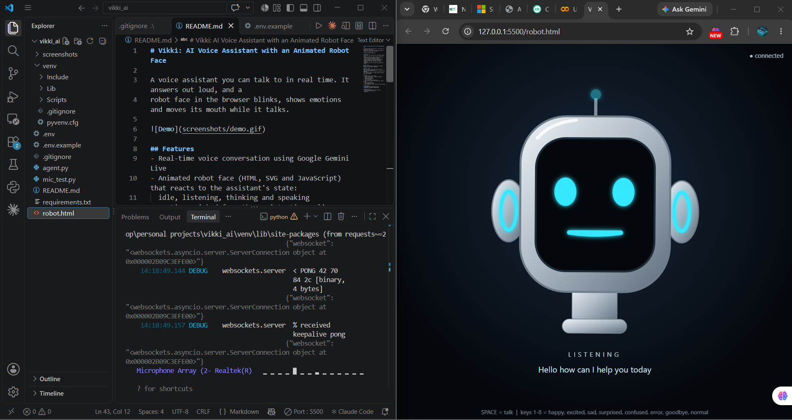
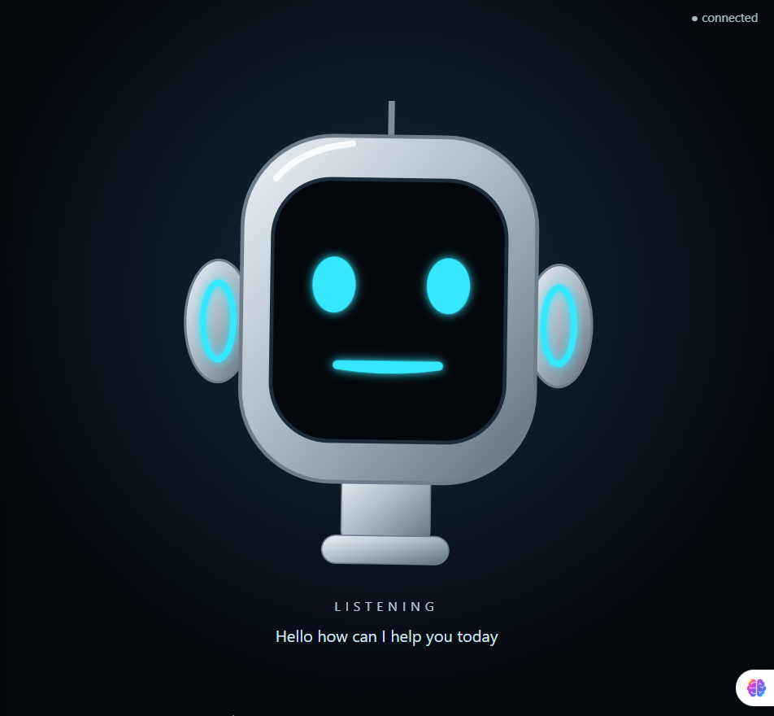

# Vikki: AI Voice Assistant with an Animated Robot Face

A voice assistant you can talk to in real time. It answers out loud, and a
robot face in the browser blinks, shows emotions and moves its mouth while it talks.

## Features
- Real-time voice conversation using Google Gemini Live
- Animated robot face (HTML, SVG and JavaScript) that reacts to the assistant's state:
  idle, listening, thinking and speaking
- Emotions picked from the assistant's replies (happy, excited, sad, surprised, confused)
- Close the assistant by voice: say "bye" or "goodbye"
- Face shows an error look when the assistant is offline

## Tech used
Python, LiveKit Agents, Google Gemini Live API, WebSockets, HTML, SVG, JavaScript

## How it works
agent.py runs the voice assistant and sends its state (listening, thinking,
speaking) and replies to robot.html through a local WebSocket
(ws://localhost:8765). The page animates the face from those messages.

## Run it
1. Install Python 3.10 or newer
2. Create and activate a virtual environment:
   python -m venv venv
   venv\Scripts\activate
3. Install packages:
   pip install -r requirements.txt
4. Copy .env.example to .env and add your Google API key
5. Start the assistant:
   python agent.py console
6. Open robot.html in your browser and start talking

## Screenshots

## Ideas for next
- Mouth movement synced to the real audio
- Web search and other tools
- Wake word